# TruthLens

**Is this image a real photo or AI-generated?** TruthLens is an AI-generated-image detector that returns a
*calibrated* probability, says **Uncertain** instead of guessing when the evidence is weak, and shows its evidence
(a class-activation heatmap, the frequency spectrum and plain-language reasons). It is evaluated on
**32 generators from families that never appear in training**, on a dataset cleaned of the file-format and
resolution shortcuts that inflate many published results.

**Headline: on 32 never-seen generators, ROC-AUC 0.927 (a UnivFD-style baseline on the same data: 0.854) with
only 3.2% of real photos flagged. On generators seen in training: 98.2% accuracy, ROC-AUC 0.998.**

**Live demo:** https://huggingface.co/spaces/Rith-P/truthlens · **Code:** https://github.com/Rithwik-P-26/truthlens · **Devpost:** https://devpost.com/software/truthlens-eo9uf8

| | |
|---|---|
| Event | Neural Storm 2026, Track 1: Future Tech |
| Problem statement | **FT-02: Deepfake & Synthetic Media Detection** |
| Team | TruthLens (solo entry) |
| Member | Rithwik Ponnana ([@Rithwik-P-26](https://github.com/Rithwik-P-26)) |

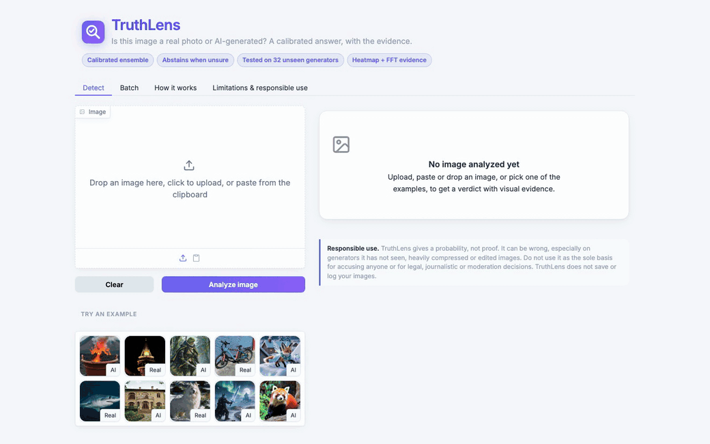

## Results at a glance

The deployed system is an equal-weight ensemble of a CLIP ViT-L/14 probe and an EfficientNet-B0 artifact CNN, with
calibration. Every model choice, calibrator and threshold was fitted on the validation split. The test splits were
scored once. Source: [`reports/RESULTS.md`](reports/RESULTS.md) and [`reports/metrics.json`](reports/metrics.json).

| Split | Images (real / AI) | Accuracy | ROC-AUC (95% CI) | F1 | ECE ↓ | Detection rate on AI | False-positive rate on real |
|---|---|---:|---:|---:|---:|---:|---:|
| `test`: same generators as training | 1,192 / 1,192 | 0.982 | 0.998 (0.996–0.999) | 0.982 | 0.006 | 0.980 | 0.015 |
| `test_unseen`: 32 held-out generators + a new real-photo domain | 2,663 / 2,663 | 0.798 | 0.927 (0.921–0.934) | 0.757 | 0.168 | 0.628 | 0.032 |

- **Ranks well on unseen generators but misses about a third of fakes.** On generators it never saw, ROC-AUC stays at
  0.927. Forced to answer at 0.5 (the table above), it catches 62.8% of fakes and wrongly flags 3.2% of real photos.
  With the Uncertain band the app uses, 58.1% of unseen fakes get an *AI-generated* verdict, 9.6% get *Uncertain*, and
  only 2.4% of real photos are called AI.
- **Abstention:** on `test_unseen` it gives a verdict for 94.1% of images, and 81.6% of those verdicts are correct.
  On `test` the figures are 98.7% and 98.7%.
- **Shortcut audit:** a classifier that sees only file metadata (format, size, JPEG quality) reaches ROC-AUC 0.577 on
  `test_unseen` after our normalization, where 0.5 is chance. The model cannot win by reading file containers.
- **Latency:** 243 ms median per 1024×1024 image on a laptop CPU (Apple M5, 2 threads). On the live ZeroGPU Space:
  about 65 ms model time, and about 4 s per request including GPU allocation (about 8 s after the Space has been idle).

## The problem

Photorealistic image generators (Midjourney, GPT-Image, FLUX, Seedream, Nano-Banana, ...) are cheap and fast. Fabricated
"photos" circulate in news feeds, insurance claims, marketplaces, dating profiles and scams, and people cannot tell them
apart by eye. Detectors that look great in papers often fail in practice, for three reasons:

1. **They overfit to the generators they were trained on**, so a new model release breaks them.
2. **They learn dataset shortcuts.** In public datasets the real photos are usually JPEGs and the fakes are PNGs of fixed
   sizes, so a classifier can score near 100% by reading the file format.
3. **They give overconfident yes/no answers with no evidence.** That is dangerous when a wrong "fake" verdict can hurt a
   real person.

## Who it is for

- **Fact-checkers and newsrooms:** triage viral images before publishing. Few real photos are flagged (3.2% on
  never-seen data), so an *AI-generated* flag is worth a closer look, and *Uncertain* routes the image to a human.
- **Trust-and-safety and marketplace moderators:** batch-score up to 50 listing or profile photos and export a CSV.
- **Insurance and claims reviewers:** an early screen for fabricated damage photos, alongside C2PA checks and reverse
  image search.
- **Everyday users:** a second opinion that shows its evidence instead of a bare yes or no.

## What TruthLens does

- **Input:** a single image (upload, paste or drag-and-drop). A batch mode scores up to 50 images and exports CSV.
- **Probability:** it returns P(AI-generated), calibrated on held-out data. On generators like those seen in training,
  about 80% of images scored 0.8 really are AI-generated.
- **Verdict:** **AI-generated**, **Real** or **Uncertain**. The verdict is Uncertain when P(AI) falls between 0.35 and
  0.65, or when the image is under 224 px.
- **Evidence:** per-model probabilities, a heatmap of the regions that pushed the CNN towards "AI", the log-magnitude
  FFT of the analysed image, and 2–4 short reasons computed from measured quantities.
- **Hard cases on purpose:** the example gallery includes a confident miss (Midjourney 6) and an abstention (a real DOCCI
  photo), so the demo shows both what the tool can do and where it fails.
- **Runs anywhere:** live on Hugging Face Spaces with ZeroGPU (a GPU slice per request), and on a laptop CPU locally. The app has a "How it works" tab with live metrics and a
  "Limitations & responsible use" tab.

## Screenshots

| Unseen generator (Veo 3) detected | Its evidence: reasons, heatmap, spectrum |
|---|---|
| 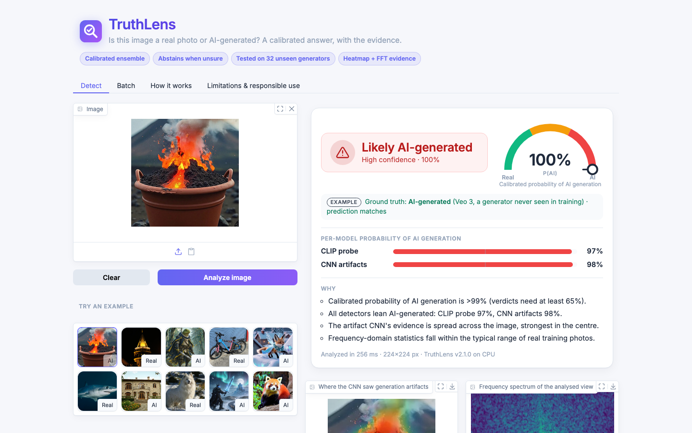 | 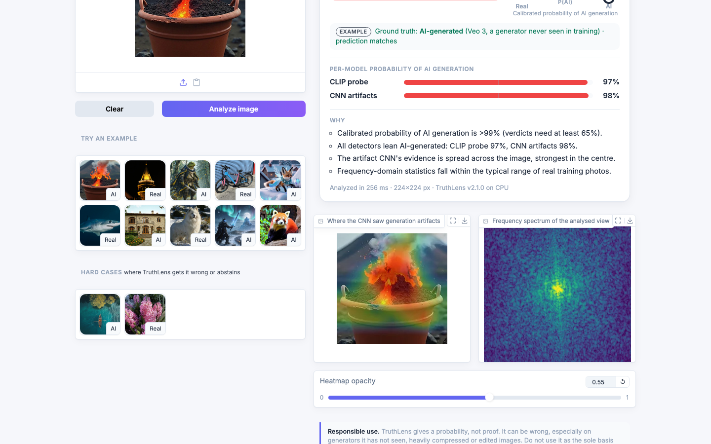 |
| **Real photo (Pexels)** | **Uncertain: a real DOCCI photo inside the 0.35–0.65 band** |
| 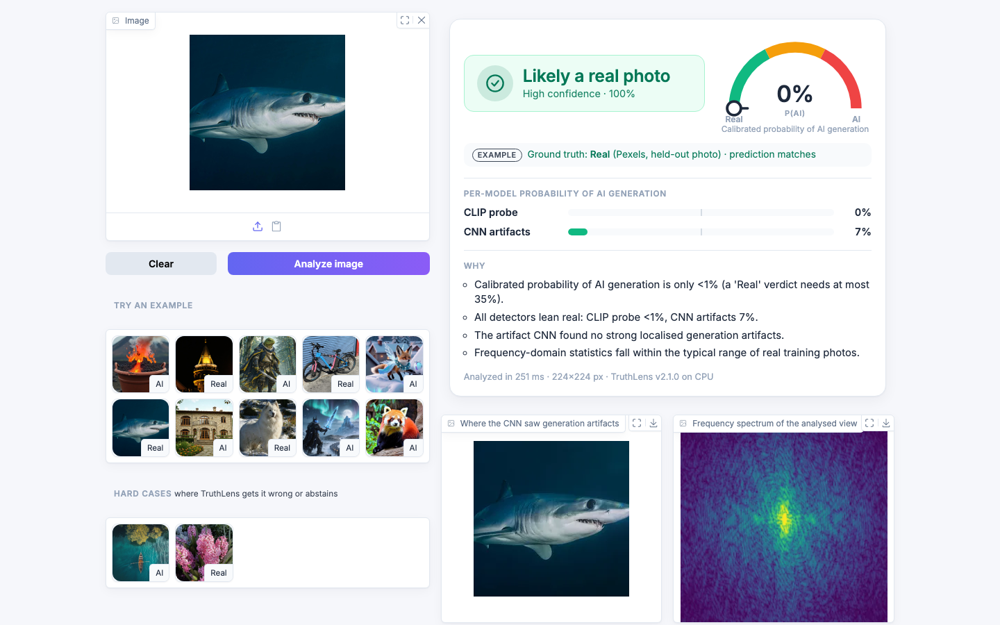 | 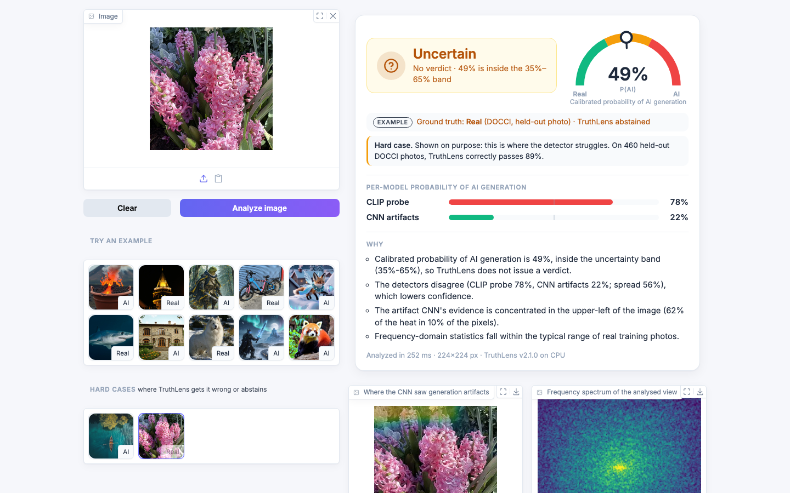 |
| **Hard case: a Midjourney 6 image it misses** | **Too small to judge (under 224 px)** |
| 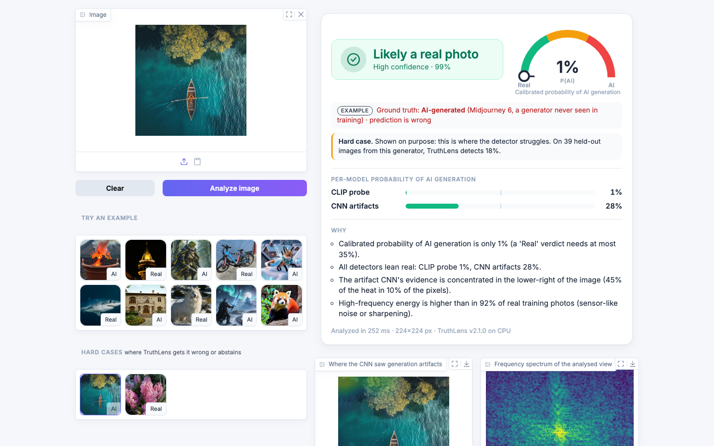 | 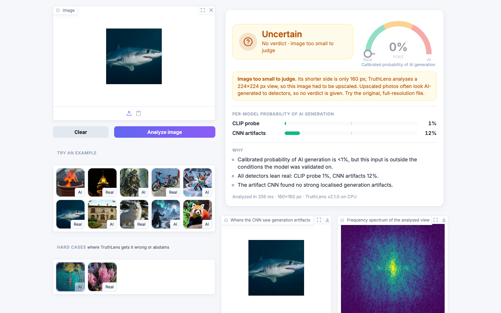 |
| **Batch mode with CSV export** | **How it works: live metrics** |
| 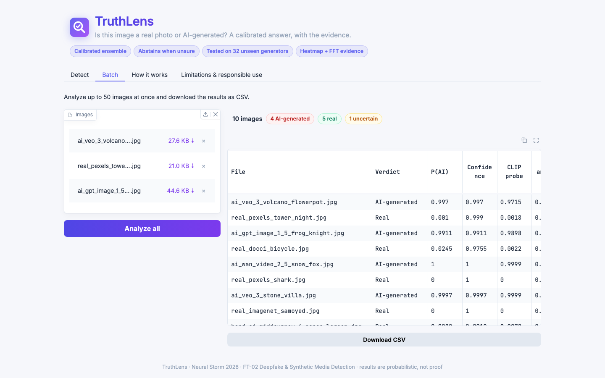 | 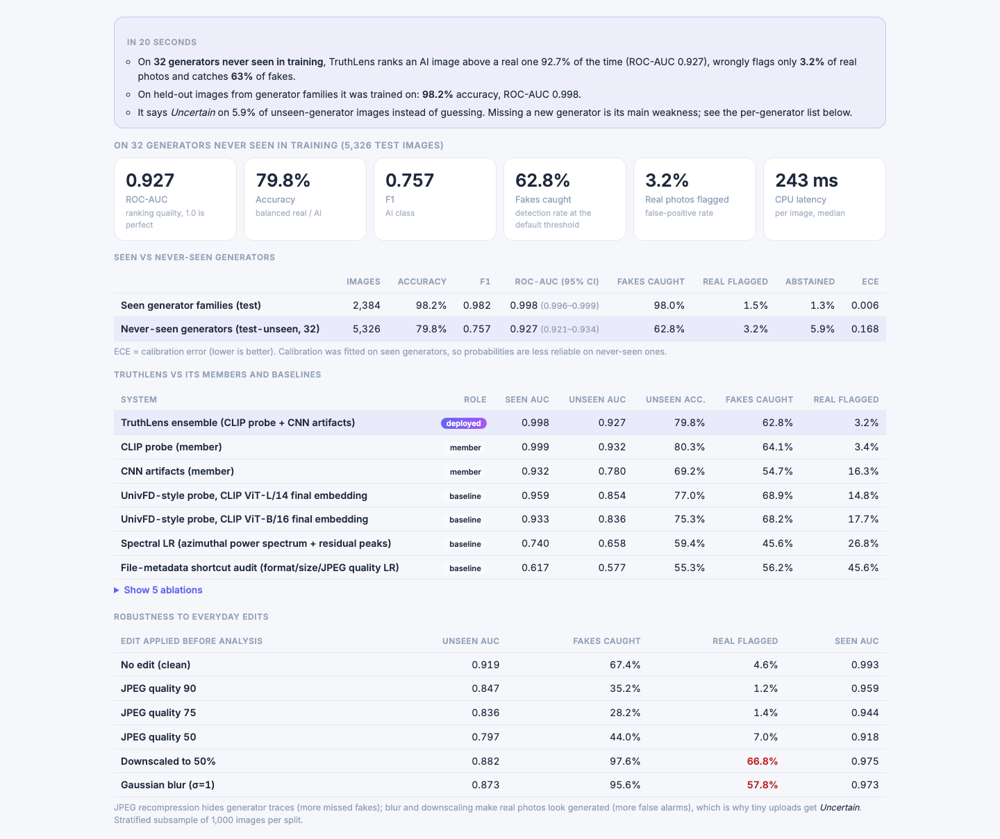 |
| **Limitations & responsible use** | |
| 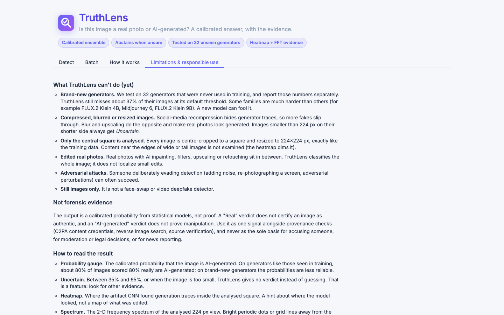 | |

## How it works

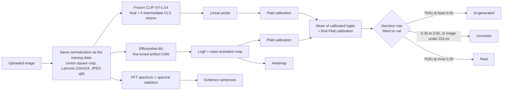

**One preprocessing policy, end to end.** Every image used in training, validation and testing, and every upload, goes
through the same normalization: centre square crop, Lanczos resize to 224×224, JPEG q95. So the test numbers above
describe what the app computes. Uploads larger than 4096 px get one extra thumbnail step first. The cost is that
fine high-frequency detail in large photos is discarded, and content outside the central square is not examined.

Two complementary detectors, because they fail differently:

| Member | What it sees | Design |
|---|---|---|
| **CLIP probe** | The global "look" of the image | A frozen OpenAI CLIP ViT-L/14 (open_clip). The features are the final projected embedding plus the CLS token of 5 intermediate blocks (5,888 dimensions). Standardized, then L2 logistic regression, with C chosen by 5-fold CV on train. |
| **CNN artifact detector** | Low-level pixel traces: texture, upsampling, noise | A timm `efficientnet_b0` (ImageNet init) with one output logit, fine-tuned for 8 epochs on 224 px images. AdamW (lr 3e-4, weight decay 0.05, cosine), bf16 on Apple MPS, sampling balanced by class and source pool. Augmentations on both classes: rescale (p 0.3, 0.5–0.95×), Gaussian blur (p 0.2), JPEG q60–100 (p 0.5), flips. Training took 27 minutes. |

**Why intermediate CLIP layers.** UnivFD (Ojha et al., 2023) showed that a linear probe on frozen CLIP features
generalizes across generators. RINE (Koutlis & Papadopoulos, 2024) showed that intermediate blocks carry useful
low-level information. We picked the probe variant by **leave-one-family-out** validation: train without one generator
family, then test on it, using train/val only. ViT-L/14 multi-layer reached mean AUC 0.985 against 0.931 for the
final-embedding (UnivFD-style) probe. `test_unseen` was not used for this choice.

**Calibration and ensemble.** Each member's logit is Platt-scaled on val. The ensemble averages the calibrated logits
with **equal weights**, then applies a final Platt calibration. The weights were fixed in advance rather than learned:
val contains only seen generators, so learned weights would over-trust whichever member overfits them. A stacked
logistic-regression ensemble is reported as an ablation.

**Uncertain band.** The threshold is 0.5 on the calibrated probability. The image gets a verdict only if the
calibrated probability of the leaning class is at least 0.65, so the band is 0.35–0.65. The rule was the smallest
confidence in [0.65, 0.90] whose val selective accuracy reached 95%. The 0.65 floor was binding: val coverage was
98.6% and selective accuracy 98.5%. Images under 224 px always get Uncertain, because upsampled real photos were often
flagged as AI in our robustness tests.

**Heatmap.** For a global-average-pool + linear head, Grad-CAM reduces exactly to CAM, and the spatial mean of the map
plus the bias equals the logit. So the heatmap is an additive decomposition of the CNN's decision over image regions.
We show its positive part ("regions pushing towards AI-generated"), divided by a **fixed** scale calibrated on val
rather than per-image max-normalization. A real photo with no evidence therefore renders dark instead of as amplified
noise. The heatmap shows where the model found evidence, not what was edited.

**Spectral features.** A 67-dimensional radial power-spectrum and residual-peak descriptor. On its own it is a weak
baseline (unseen AUC 0.658), and adding it to the ensemble changed little (0.929 vs 0.927), so it is not a member. Its
statistics, compared with percentiles of real training photos, are used only to phrase one evidence sentence.

## Data pipeline: removing shortcuts

Details: [`docs/DATA_CARD.md`](docs/DATA_CARD.md). Script: [`scripts/prepare_data.py`](scripts/prepare_data.py) (seed 1337).

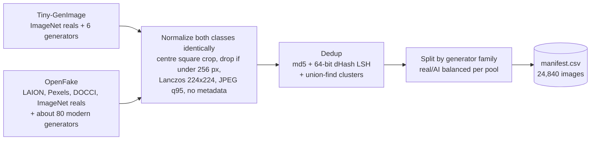

The raw data had strong label-correlated shortcuts. We measured them and then removed them:

| Property in raw data | Real | AI |
|---|---|---|
| File format, GenImage | 100% JPEG | 100% PNG |
| Median shorter side, OpenFake | 534 px | 1024 px |
| Exactly square, GenImage | 3% | 100% |
| Has EXIF, OpenFake | 7% | 20% |

After normalization every image is a 224×224 RGB JPEG q95 with no metadata. The metadata-only audit model scores AUC
0.617 on `test` and 0.577 on `test_unseen`. The remaining weak signal is mostly JPEG bits per pixel, which reflects
image texture. Other hygiene steps:

- **Near-duplicate removal** across datasets (dHash Hamming distance ≤ 4). Clusters containing both labels, such as a
  real photo and a fake made from it, are dropped entirely. One image per cluster is kept, so no near-identical pair
  crosses splits.
- **Balanced pools:** within each source pool and split, real and AI counts are equal, so "which dataset does this look
  like" cannot predict the label.
- **Content matching:** GenImage fakes are generated from ImageNet class names, and OpenFake fakes from captions of the
  real images.
- **Source weighting:** about 84% of the AI training images are GenImage (ImageNet content, 2022-era generators).
  Modern generators are up-weighted by source pool, with α = 0.5 fixed in advance.

### Content filtering (dataset v2.1)

We found explicit images in the web-scale source data, mostly from anime/"Pony" fine-tunes in OpenFake and from
LAION. Every image was scanned with three signals, and removed if any of them fired:

- an NSFW image classifier (Falconsai, p ≥ 0.30);
- the Stable Diffusion safety checker applied to CLIP ViT-L/14 embeddings;
- a prompt keyword filter.

**Real and AI images went through the same filter.** Otherwise "was it filtered?" would become a new label shortcut.

- 1,841 of 24,840 images were flagged (4.8% of reals, 10.0% of fakes).
- 9 generators with at least 25% flagged images were dropped entirely, including the unseen Illustrious and ERNIE-Image-Turbo.
- 4 more anime-style generators were dropped as a precaution, because NSFW classifiers are least reliable on anime.
- The removed images were replaced with clean, filtered images, so split sizes and class balance are unchanged.
- The result was spot-checked by hand.

Retraining with the same protocol changed little:

- seen `test`: AUC 0.998 → 0.998, accuracy 0.982 → 0.982;
- `test_unseen`: AUC 0.935 → 0.927, accuracy 0.811 → 0.798.

The unseen set's composition changed, so this is not a controlled comparison. Details are in
[`docs/DATA_CARD.md`](docs/DATA_CARD.md#content-filtering-v2), and the v1 results are archived in
[`reports/archive_v1/`](reports/archive_v1/RESULTS.md).

| Split | Real | AI | AI generators |
|---|---:|---:|---|
| train | 7,569 | 7,569 | 38 seen generators: 5 GenImage + 33 OpenFake (SD 1.x/2.1/3.5, SDXL and fine-tunes, FLUX.1, Imagen 3, Kolors, HiDream, Playground, ...) |
| val | 996 | 996 | same pool as train |
| test | 1,192 | 1,192 | same pool as train |
| test_unseen | 2,663 | 2,663 | **32 generators from held-out families**: Midjourney v5/6/7, DALL-E 3, GPT-Image 1/1.5/2, FLUX.2, Seedream 4/4.5/5, Nano-Banana, Imagen 4, Ideogram, Recraft, Z-Image-Turbo, Sora 2, Veo 3, Wan, ... |

## Evaluation methodology

- **Hold-out by generator family, not by image.** Any model whose name starts with a held-out family prefix
  (midjourney, gpt-image, flux.2, seedream, ...) is excluded from train, val and test. The data script asserts that no
  generator appears in both train/val and `test_unseen`, and the training code checks it again.
- **New real photos too.** `test_unseen` includes a real-photo source never seen in training (DOCCI). It therefore
  measures false positives on unfamiliar real photos as well as recall on unfamiliar generators. We report detection
  rate and false-positive rate separately.
- **Nothing is tuned on test.** Hyperparameters are chosen by cross-validation on train. Calibration, the ensemble, the
  uncertainty band and the heatmap scale are fitted on val. The CLIP probe is selected by leave-one-family-out on
  train/val.
- **Comparable baselines:** every non-deployed system is Platt-calibrated on val before scoring.
- **Uncertainty:** 95% stratified bootstrap intervals (1,000 resamples) for AUC and accuracy.
- **Robustness:** a stratified subsample of 1,000 images per split is perturbed and re-scored end to end. The
  perturbations are JPEG q90/75/50, 0.5× downscale and Gaussian blur σ=1, all with the deployed thresholds.
- **Honest caveats.** Some unseen families are near neighbours of seen ones: FLUX.1 is seen and FLUX.2 unseen, and Imagen 3
  is seen and Imagen 4 unseen. Many unseen generators have fewer than
  50 images.

## Results

### Members, ensemble and baselines

| System | Kind | Test AUC | Test acc. | Unseen AUC | Unseen acc. | Unseen det. rate | Unseen FPR | Unseen ECE |
|---|---|---:|---:|---:|---:|---:|---:|---:|
| **TruthLens ensemble (CLIP probe + CNN)** | deployed | **0.998** | **0.982** | **0.927** | **0.798** | 0.628 | 0.032 | 0.168 |
| CLIP ViT-L/14 multi-layer probe | member | 0.999 | 0.983 | 0.932 | 0.803 | 0.641 | 0.034 | 0.161 |
| EfficientNet-B0 artifact CNN | member | 0.932 | 0.852 | 0.780 | 0.692 | 0.547 | 0.163 | 0.136 |
| UnivFD-style probe, CLIP ViT-L/14 final embedding | baseline | 0.959 | 0.889 | 0.854 | 0.770 | 0.689 | 0.148 | 0.102 |
| UnivFD-style probe, CLIP ViT-B/16 final embedding | baseline | 0.933 | 0.850 | 0.836 | 0.753 | 0.682 | 0.177 | 0.075 |
| Spectral LR | baseline | 0.740 | 0.674 | 0.658 | 0.594 | 0.456 | 0.268 | 0.077 |
| File-metadata shortcut audit | sanity check | 0.617 | 0.579 | 0.577 | 0.553 | 0.562 | 0.456 | 0.015 |
| Stacked-LR ensemble (weights fit on val) | ablation | 0.999 | 0.984 | 0.933 | 0.805 | 0.643 | 0.032 | 0.164 |
| Ensemble + spectral member | ablation | 0.998 | 0.980 | 0.929 | 0.803 | 0.641 | 0.035 | 0.163 |
| Ensemble before calibration (mean raw logit) | ablation | 0.994 | 0.964 | 0.899 | 0.769 | 0.589 | 0.051 | 0.179 |
| Fast config (CLIP ViT-B/16 probe + CNN) | ablation | 0.994 | 0.966 | 0.900 | 0.782 | 0.614 | 0.050 | 0.166 |

Our reading of the table:

- **Multi-layer features matter.** The multi-layer probe beats the UnivFD-style final-embedding probe on unseen
  generators: AUC 0.932 vs 0.854, with FPR 0.034 vs 0.148.
- **The ensemble does not beat CLIP on clean data.** It is slightly below the CLIP probe alone on clean unseen data
  (0.927 vs 0.932), but more robust under JPEG compression (see the robustness table). The ensemble design was fixed
  before test results were seen. The stacked-LR row is shown for comparison and was not selected after the fact.
- **Calibration does not transfer fully.** It was fitted on val, which contains seen generators only: ECE is 0.006 on
  `test` and 0.168 on `test_unseen`. Probabilities on brand-new generators are less reliable, as the reliability
  diagram below shows.

### Never-seen generators and real photos (`test_unseen`, deployed ensemble)

| Source | Label | n | Detection rate (AI) / correct pass rate (real) | ROC-AUC vs reals |
|---|---|---:|---:|---:|
| ImageNet | real | 1,753 | 0.994 (FPR 0.006) | |
| Pexels | real | 195 | 0.969 (FPR 0.031) | |
| LAION | real | 255 | 0.925 (FPR 0.075) | |
| **DOCCI (new real domain)** | real | 460 | **0.893 (FPR 0.107)** | |
| Wan 2.5 | AI | 40 | 0.975 | 0.988 |
| FLUX.2 klein base 4B | AI | 31 | 0.968 | 0.993 |
| Veo 3 | AI | 77 | 0.922 | 0.990 |
| Z-Image-Turbo | AI | 427 | 0.763 | 0.967 |
| Midjourney 7 | AI | 134 | 0.731 | 0.954 |
| GPT-Image-1.5 | AI | 193 | 0.710 | 0.948 |
| Midjourney v5 | AI | 800 | 0.635 | 0.941 |
| Recraft v3 | AI | 42 | 0.333 | 0.808 |
| FLUX.2 klein 9B | AI | 337 | 0.208 | 0.795 |
| Midjourney 6 | AI | 39 | 0.179 | 0.849 |
| FLUX.2 klein 4B | AI | 34 | 0.088 | 0.720 |

Shown: every unseen generator with n ≥ 100, plus the three easiest and the three hardest of the rest (n ≥ 30). All 32
are listed in [`reports/RESULTS.md`](reports/RESULTS.md). Even the hardest families have AUC 0.72–0.85: the model ranks them above
real photos more often than not, but its scores for them fall below the threshold.

### Abstention (selective prediction)

| Split | Answered (coverage) | Accuracy on answered | Accuracy if forced to answer |
|---|---:|---:|---:|
| test | 0.987 | 0.987 | 0.982 |
| test_unseen | 0.941 | 0.816 | 0.798 |

Breakdown on `test_unseen`:

| Truth | Predicted Real | Uncertain | Predicted AI |
|---|---:|---:|---:|
| Real | 2,540 | 60 | 63 |
| AI | 861 | 256 | 1,546 |

The dominant error on new generators is a missed fake, not a false accusation.

### Robustness (ROC-AUC on a stratified `test_unseen` subsample)

| Perturbation | CLIP probe | CNN | Ensemble | Ensemble det. rate | Ensemble FPR |
|---|---:|---:|---:|---:|---:|
| clean | 0.927 | 0.748 | 0.919 | 0.674 | 0.046 |
| JPEG q90 | 0.837 | 0.737 | 0.847 | 0.352 | 0.012 |
| JPEG q75 | 0.820 | 0.738 | 0.836 | 0.282 | 0.014 |
| JPEG q50 | 0.777 | 0.717 | 0.797 | 0.440 | 0.070 |
| Downscale 0.5× | 0.888 | 0.704 | 0.882 | 0.976 | **0.668** |
| Gaussian blur σ=1 | 0.875 | 0.702 | 0.873 | 0.956 | **0.578** |

JPEG recompression hides generator traces, so more fakes are missed. Blur and downscaling (which the 224 px
normalization then upsamples) do the opposite: the ranking stays reasonable (AUC 0.87–0.88), but at the 0.5 threshold
most real photos are flagged as AI. This is why the app answers Uncertain for images under 224 px. Blur cannot be
detected reliably and remains a limitation. The perturbation is applied to the 224 px normalized image, so an upload
degraded at full resolution is partly "cleaned" by the downscale, and these numbers are conservative.

### CPU latency (`Detector.predict`, batch 1, 2 threads, median)

| Upload size | Normalize | CLIP ViT-L/14 | CNN + CAM | Spectral | End to end | Fast config (ViT-B/16) |
|---|---:|---:|---:|---:|---:|---:|
| 224×224 | 1 ms | 154 ms | 65 ms | 4 ms | 224 ms | 109 ms |
| 1024×1024 | 3 ms | 154 ms | 64 ms | 4 ms | 243 ms | 128 ms |
| 4032×3024 | 13 ms | 154 ms | 63 ms | 4 ms | 302 ms | 187 ms |

These numbers are from an Apple M5 CPU with `torch.set_num_threads(2)`; the model loads in 5.1 s. They were measured
with the v1 weights; v2.1 has the same architecture and input size. PyTorch on Apple
silicon uses Accelerate/AMX for matrix multiplies, so the ViT runs faster here than it would on a small x86 CPU. The live
Space runs on Hugging Face ZeroGPU (a GPU slice per request). Measured on 2026-11-03 through the public API, warm model
time was 63–65 ms per image (395 ms on a cold first call), and wall-clock time was about 4.2 s per request (8.4 s cold),
including GPU allocation and upload. Each result in the app shows its own measured latency. The backbone cost benchmark that
informed the choice is in [`reports/backbone_benchmark.md`](reports/backbone_benchmark.md).

### Figures

| ROC curves | Reliability diagram |
|---|---|
| 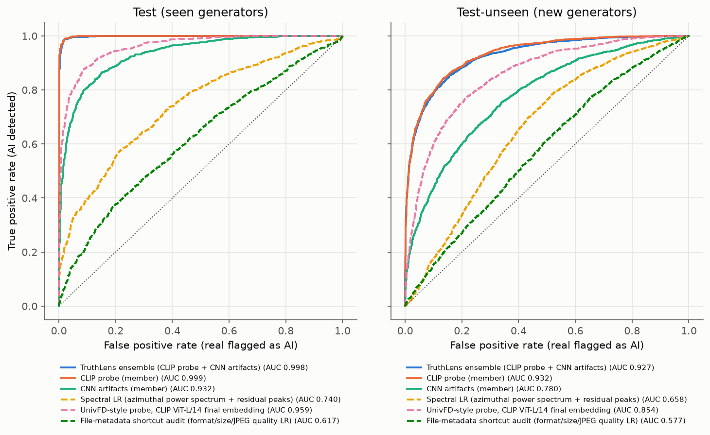 | 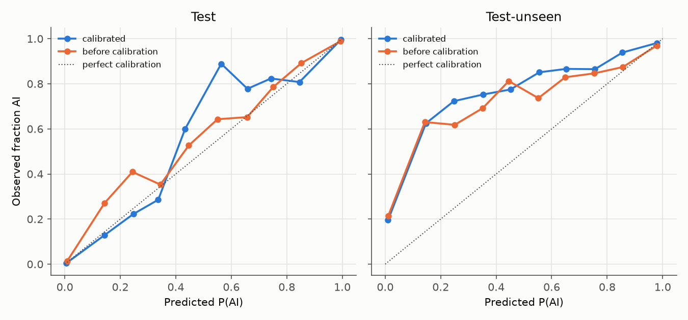 |
| **Per unseen generator** | **Robustness** |
| 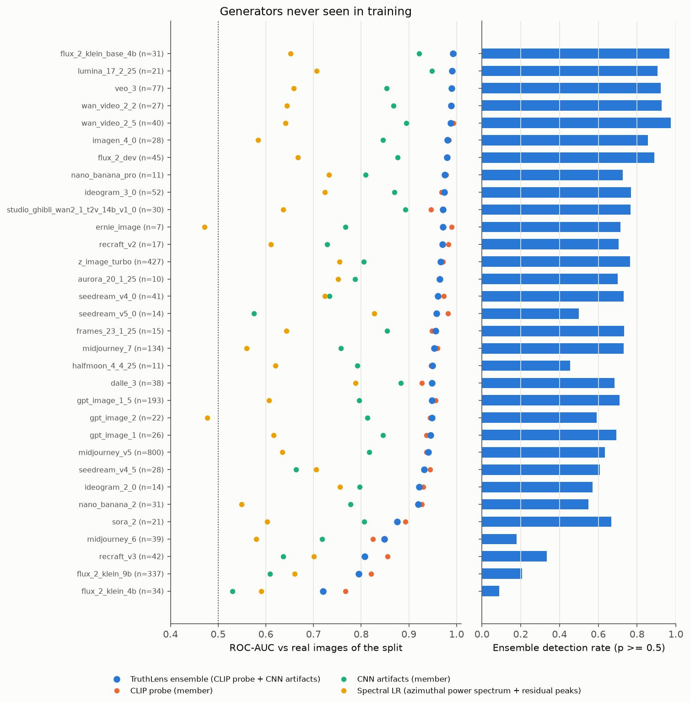 | 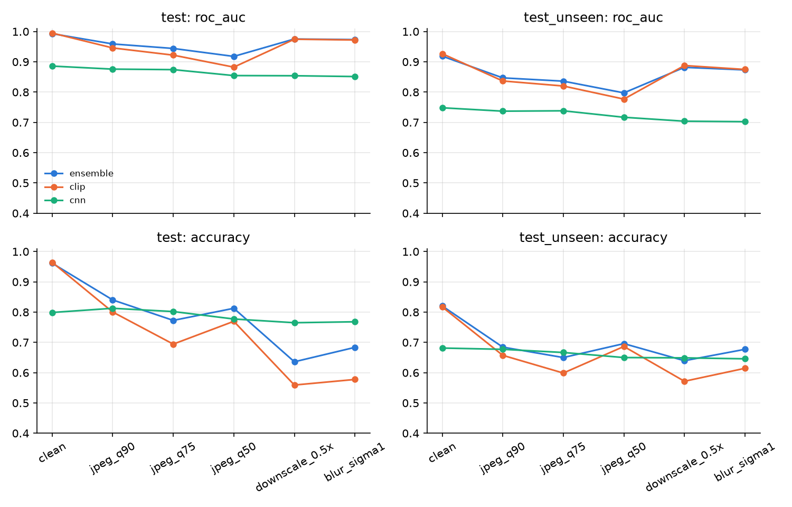 |
| **Risk–coverage** | **Confusion matrices** |
| 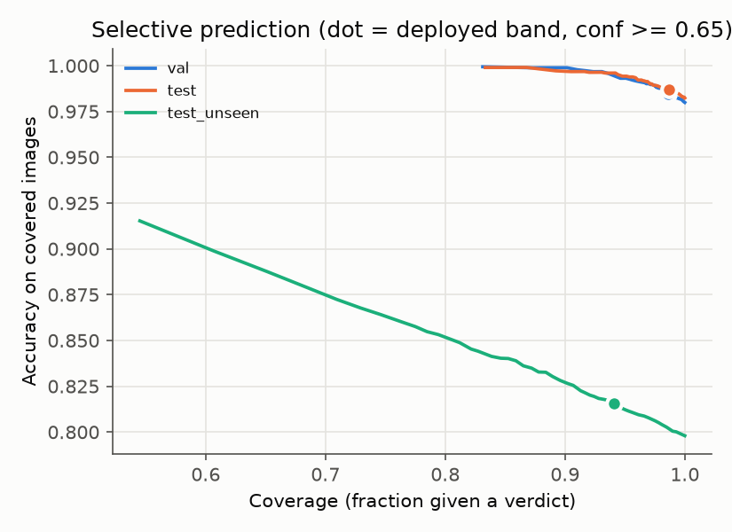 | 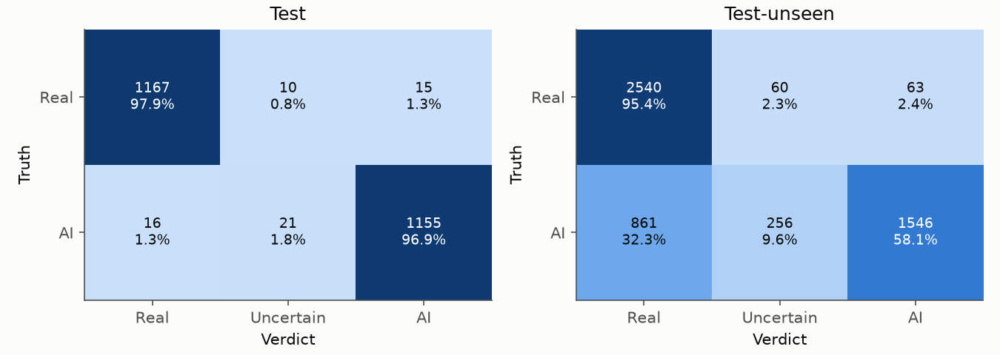 |
| **CNN training curves** | **Images per source and split** |
| 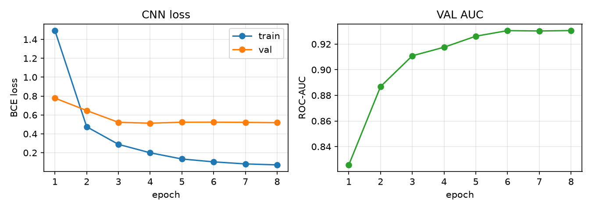 | 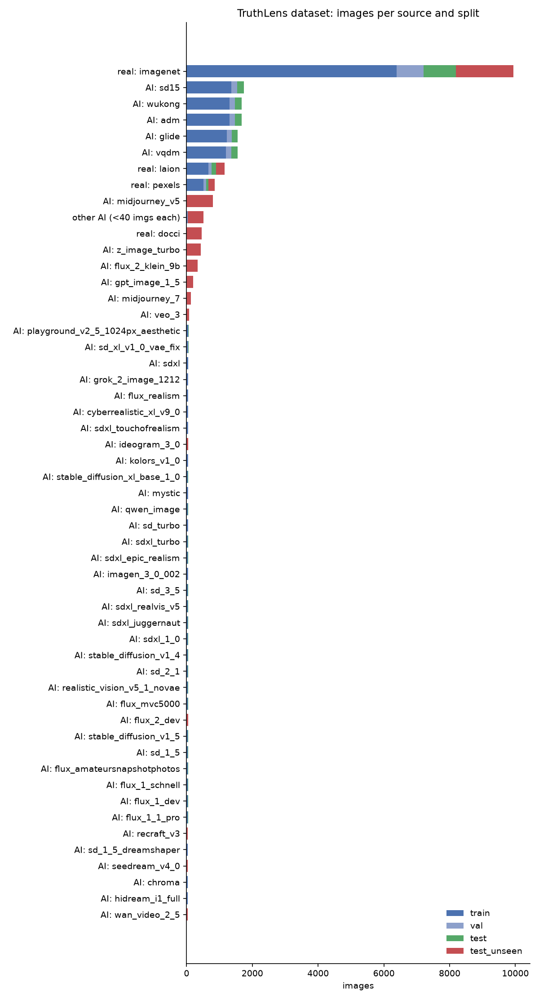 |

## Quickstart

Requirements: macOS or Linux and Python 3.11. With [uv](https://docs.astral.sh/uv/) (`curl -LsSf
https://astral.sh/uv/install.sh | sh`), Python 3.11 is fetched automatically; the pip path needs `python3.11` on PATH
(e.g. `brew install python@3.11` or `apt install python3.11 python3.11-venv`). The runtime environment is about
1.4 GB. On first run the CLIP ViT-L/14 weights (about 1.7 GB, `timm/vit_large_patch14_clip_224.openai`) download from
the Hugging Face Hub. The trained heads and the 16.2 MB CNN weights are in this repository under `models/`.

```bash
git clone https://github.com/Rithwik-P-26/truthlens.git
cd truthlens

# with uv (recommended)
uv venv --python 3.11 .venv
uv pip install --python .venv/bin/python -r requirements.txt

# or with pip
python3.11 -m venv .venv
.venv/bin/pip install -r requirements.txt
```

`requirements.txt` contains only the app's runtime dependencies, using CPU PyTorch wheels. Training, evaluation and
tests need `requirements-train.txt` as well.

### Run the app

```bash
.venv/bin/python app.py          # http://127.0.0.1:7860
```

| Variable | Effect |
|---|---|
| `PORT` / `GRADIO_SERVER_PORT` | Port (default 7860) |
| `TRUTHLENS_CONFIG=config_fast.json` | ViT-B/16 configuration, about 2× faster (unseen AUC 0.900 vs 0.927) |
| `TRUTHLENS_DEVICE` | Torch device (default `cpu` locally; set to `cuda` automatically on the ZeroGPU Space) |
| `TRUTHLENS_FORCE_STUB=1` | Simulated detector for UI work without weights (the app labels this "Demo mode") |

Python API:

```python
import sys; sys.path.insert(0, "src")
from PIL import Image
from truthlens.inference import Detector

det = Detector("models")
out = det.predict(Image.open("examples/ai_veo_3_volcano_flowerpot.jpg").convert("RGB"))
print(out["verdict"], round(out["prob_ai"], 3), out["models"], out["explanation"])
```

### Tests

```bash
uv pip install --python .venv/bin/python -r requirements-train.txt   # or: .venv/bin/pip install -r requirements-train.txt
.venv/bin/python -m pytest -q tests      # 15 tests, about 10 s once the CLIP weights are cached
```

The tests cover the inference contract, equivalence between the app's normalization and the data pipeline's, the
stub, and that the app builds and the Space assembles.

### Reproduce the results

Runs on a single Apple-silicon Mac (MPS); CUDA also works. The CNN fine-tune took 27 minutes on an Apple M5 with 24 GB;
feature extraction and evaluation add to that.

```bash
uv pip install --python .venv/bin/python -r requirements-train.txt

# 1. Data: download, normalize, dedup, split, audit (~10 min; ~13 GB transient download, 0.9 GB kept)
.venv/bin/python scripts/prepare_data.py --stage all

# 1b. Content filter (three signals, same for real and AI), drop flagged generators, top up -> dataset v2.1
.venv/bin/python scripts/prepare_data_filter.py --stage all

# 2. Cache CLIP (ViT-L/14, ViT-B/16) and spectral/metadata features for every image
.venv/bin/python scripts/train_features.py

# 3. Linear heads (CLIP probes, spectral, metadata audit) + leave-one-family-out selection
.venv/bin/python scripts/train_heads.py

# 4. Fine-tune the CNN artifact detector
.venv/bin/python scripts/train_cnn.py --epochs 8

# 5. Calibration, ensemble, uncertainty band -> models/config.json
.venv/bin/python scripts/train_ensemble.py

# 6. Evaluation -> reports/metrics.json, reports/RESULTS.md, reports/figures/
.venv/bin/python scripts/eval_models.py
.venv/bin/python scripts/eval_robustness.py
.venv/bin/python scripts/eval_latency.py
```

Every script has `--help`. Apart from `--epochs 8` for the CNN (recorded in `reports/cnn_training.json`), the
defaults are the settings used for the reported results.

To regenerate the README media, run `.venv/bin/python scripts/capture_media.py`. It needs Playwright and ffmpeg (see the
script header).

## Repository structure

```
app.py                     Gradio app (Hugging Face Spaces entry point)
src/truthlens/
  inference.py             Detector: the public inference API
  features.py              Normalization, CLIP embedder, spectral features, perturbations
  models.py                Linear heads (.npz) and the CNN detector with exact CAM
  calibrate.py             Platt/isotonic calibration, ensemble, uncertainty band, ECE
  explain.py               Heatmap scaling and evidence sentences
  train.py                 Manifest checks, augmentations, CNN training, leave-one-family-out evaluation
  metrics.py               Metrics and bootstrap confidence intervals
  ui.py, stub.py           App rendering helpers and the demo-mode stub detector
scripts/                   prepare_data, prepare_data_filter/_nsfw (content filter), train_*, eval_*,
                           build_space (Space folder), capture_media (README media)
models/                    config.json (v2.1.0), config_fast.json, CLIP heads (.npz), CNN weights (.safetensors)
reports/                   metrics.json, RESULTS.md, robustness/latency/head-selection JSON, figures/, archive_v1/
examples/                  12 held-out demo images with provenance (examples/README.md, labels.csv)
tests/                     pytest suite
docs/                      DATA_CARD.md, screenshots/, demo.gif, SUBMISSION_CHECKLIST.md
assets/style.css           App styling
```

## Tech stack

| Area | Tools |
|---|---|
| Language | Python 3.11 |
| Deep learning | PyTorch (Apple MPS for training; CPU locally and ZeroGPU/CUDA on the Space for serving), torchvision |
| Pretrained models | [open_clip](https://github.com/mlfoundations/open_clip) (OpenAI CLIP ViT-L/14 and ViT-B/16), [timm](https://github.com/huggingface/pytorch-image-models) (ImageNet EfficientNet-B0) |
| Classical ML | scikit-learn (logistic regression, cross-validation), NumPy, SciPy |
| Data | Hugging Face `datasets` / `huggingface_hub` (streams parquet row groups), pandas, Pillow |
| Model files | safetensors and plain `.npz`/JSON (no pickle at inference) |
| App | Gradio 6 on Hugging Face Spaces |
| Tooling | pytest, Matplotlib, Playwright + ffmpeg (README media), uv |

## Responsible AI

**Not forensic proof.** TruthLens outputs a statistical probability. A "Real" verdict does not certify authenticity,
and an "AI-generated" verdict does not prove manipulation. Do not use it as the sole basis for accusing anyone, or for
legal, journalistic or moderation decisions. Use it alongside provenance checks such as C2PA content credentials,
reverse image search and source verification.

**Known failure modes (measured above)**

- **New generators.** On unseen families it misses more than a third of fakes at the default threshold (detection rate
  0.628), and some families are much harder: FLUX.2 klein 4B/9B and Midjourney 6 are caught at most 21% of the
  time. A future model can fool it.
- **Prompts that ask for a real-photo look.** A generator told to imitate an amateur phone snapshot (grain, soft
  focus, flat lighting, casual framing) removes the polished look the CLIP probe associates with AI and masks the pixel
  traces the CNN looks for. In a manual test, a Gemini image made with a prompt asking it to look non-AI-generated was
  called Real at 99%. Gemini's generator (Nano-Banana) is a held-out family, and only 17 of 31 Nano-Banana 2 and 8 of
  11 Nano-Banana Pro test images are caught. Both members are fooled by the same look, so they
  agree and the ensemble can be confidently wrong instead of Uncertain (see calibration shift below). Gemini images
  carry Google's SynthID watermark, which TruthLens cannot read.
- **Unfamiliar real photos.** 10.7% of DOCCI real photos, a domain never seen in training, are wrongly flagged as AI,
  against 0.6% of ImageNet photos. Errors are not evenly distributed across sources, cameras and content.
- **Compression, blur and resizing.** JPEG recompression hides traces (more missed fakes). Blur and upsampling make real
  photos look generated: 58–67% false positives in the robustness test. Images under 224 px therefore always get
  Uncertain, but blur is not detected.
- **Only the central square at 224 px is analysed.** Content near the edges of wide or tall images is not examined, and
  fine detail in large photos is discarded by design.
- **Edited real photos.** Inpainting, filters, AI upscaling and retouching sit between the classes. TruthLens
  classifies the whole image and does not localize edits.
- **Adversarial evasion.** Deliberate noise, re-photographing a screen or adversarial perturbations can defeat it.
- **Scope.** Still images only. It is not a face-swap or video deepfake detector.
- **Calibration shift.** Probabilities are well calibrated on seen generators (ECE 0.006) but much less so on unseen
  ones (ECE 0.168).
- **Label noise.** Labels come from the source datasets and were not manually verified. LAION "real" images are web
  images that may themselves be edited.

**Privacy.** The app processes uploads in memory to compute the result. It does not save, log or train on images.
Gradio on Hugging Face Spaces keeps temporary upload files for the session.

**Training-data content.** Explicit images were removed from the training and evaluation data with automatic filters
and a manual spot-check ([content filtering](#content-filtering-dataset-v21)). Automatic filters are imperfect, so some
unwanted content may remain. Real and AI images were filtered identically, so the filter does not bias the labels.

**Licenses.**

- The **code** is MIT ([LICENSE](LICENSE)).
- The **datasets are non-commercial**:
  - GenImage via Tiny-GenImage: CC BY-NC-SA 4.0, with real images under the ImageNet terms of access.
  - OpenFake: CC BY-NC 4.0. Its real images keep their upstream terms: LAION (web copyright), the Pexels License,
    DOCCI (CC BY 4.0) and ImageNet.
- The **example images and the trained weights** are therefore for non-commercial research and demo use only.
  Provenance for every example: [`examples/README.md`](examples/README.md).

## Use of AI development tools

This project was built with **Claude Code (Anthropic, Claude Opus 5.5)** as an AI coding assistant and agent. Claude
Code ran as a lead agent that coordinated specialised sub-agents for the data pipeline, modelling, the app and the
documentation. It wrote most of the code, ran the data-preparation, training and evaluation experiments, and drafted
this documentation.

The human author, Rithwik Ponnana:

- chose the problem statement and the per-agent settings;
- directed the work and made the project decisions;
- did all git, GitHub and Hugging Face publishing.

All work was done during the hackathon window (2–4 November 2026).

The product itself uses pretrained models (OpenAI CLIP, ImageNet-pretrained EfficientNet-B0). The AI-generated images
used for training and evaluation come from the public datasets above; no new images were generated for this project.

## Future work

- Analyse full-resolution crops alongside the 224 px view, so fine generator traces in large photos are not discarded.
  This needs training data that keeps native resolution without reintroducing the size shortcut.
- Add more recent generators and real-photo domains (especially phone photos), and recalibrate on a broader val set to
  reduce the calibration gap on unseen generators.
- Detect blur and upsampling and abstain on them, rather than only on images under 224 px.
- Combine with provenance signals (C2PA manifests, invisible watermarks) when present, and localize partial edits.
- Extend to video and face swaps. Distil the ensemble for faster CPU inference.
- A browser extension and an API for newsroom and trust-and-safety workflows.

## Acknowledgements and citations

- U. Ojha, Y. Li, Y. J. Lee. *Towards Universal Fake Image Detectors that Generalize Across Generative Models*
  (UnivFD). CVPR 2023. [arXiv:2302.10174](https://arxiv.org/abs/2302.10174)
- C. Koutlis, S. Papadopoulos. *Leveraging Representations from Intermediate Encoder-blocks for Synthetic Image
  Detection* (RINE). ECCV 2024. [arXiv:2402.19091](https://arxiv.org/abs/2402.19091)
- M. Zhu, H. Chen, Q. Yan, X. Huang, G. Lin, W. Li, Z. Tu, H. Hu, J. Hu, Y. Wang. *GenImage: A Million-Scale Benchmark
  for Detecting AI-Generated Image*. NeurIPS 2023 (Datasets and Benchmarks).
  [arXiv:2306.08571](https://arxiv.org/abs/2306.08571). Subset used:
  [TheKernel01/Tiny-GenImage](https://huggingface.co/datasets/TheKernel01/Tiny-GenImage).
- V. Livernoche et al. *OpenFake: An Open Dataset and Platform Toward Real-World Deepfake Detection*. 2025.
  [arXiv:2509.09495](https://arxiv.org/abs/2509.09495). Dataset:
  [ComplexDataLab/OpenFake](https://huggingface.co/datasets/ComplexDataLab/OpenFake).
- A. Radford et al. *Learning Transferable Visual Models From Natural Language Supervision* (CLIP). ICML 2021.
  G. Ilharco et al. *OpenCLIP*, 2021.
- M. Tan, Q. V. Le. *EfficientNet: Rethinking Model Scaling for Convolutional Neural Networks*. ICML 2019.
  R. Wightman. *PyTorch Image Models (timm)*, 2019.
- B. Zhou et al. *Learning Deep Features for Discriminative Localization* (CAM). CVPR 2016.
  R. R. Selvaraju et al. *Grad-CAM: Visual Explanations from Deep Networks via Gradient-based Localization*. ICCV 2017.
- S.-Y. Wang et al. *CNN-generated images are surprisingly easy to spot... for now*. CVPR 2020 (the blur + JPEG
  augmentation recipe).
- J. Platt. *Probabilistic Outputs for Support Vector Machines and Comparisons to Regularized Likelihood Methods*, 1999.
  C. Guo et al. *On Calibration of Modern Neural Networks*. ICML 2017.
- The real photographs come from ImageNet, LAION, Pexels and DOCCI (Google), via the datasets above.

Built for Neural Storm 2026.
