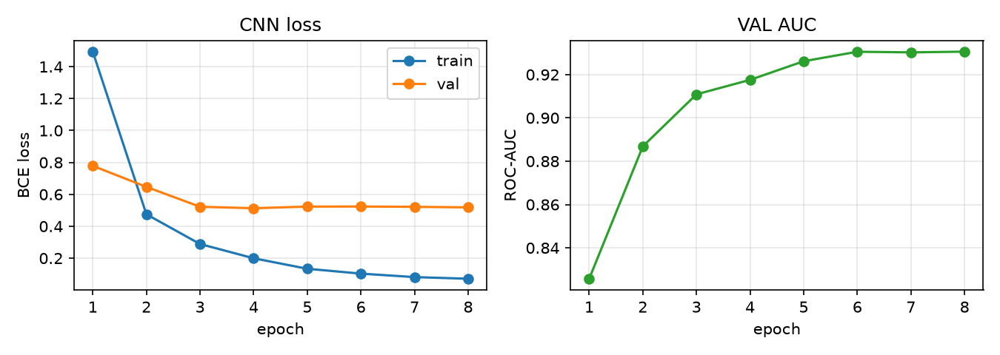
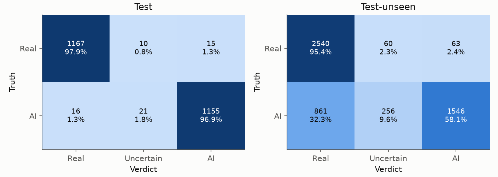
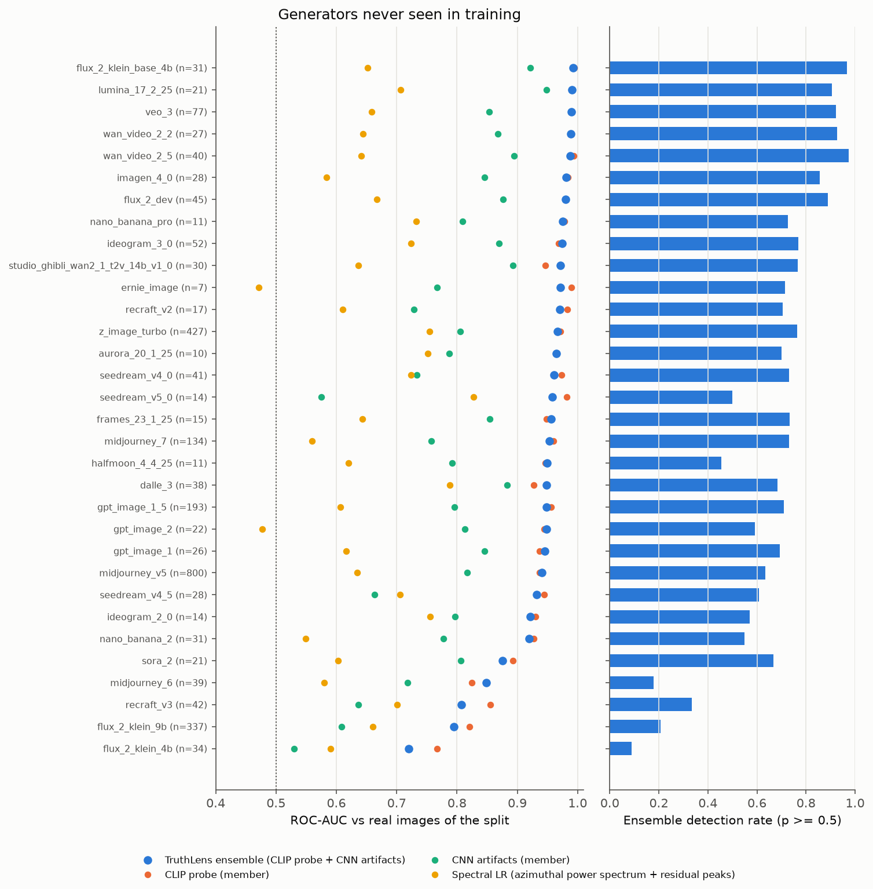
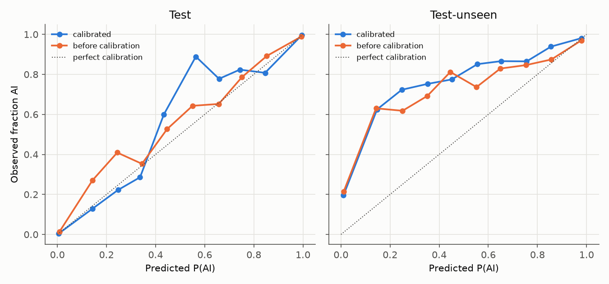
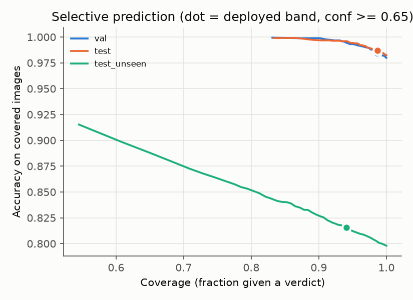
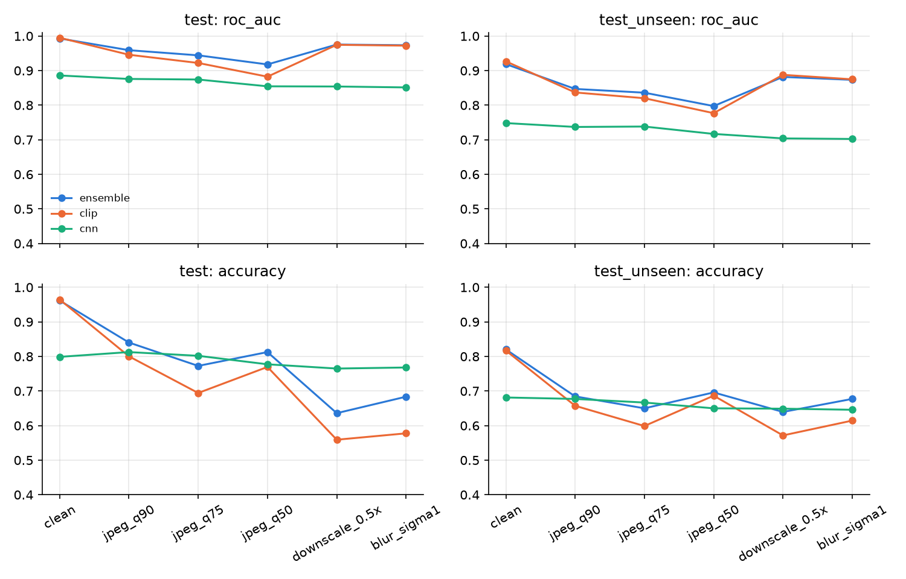
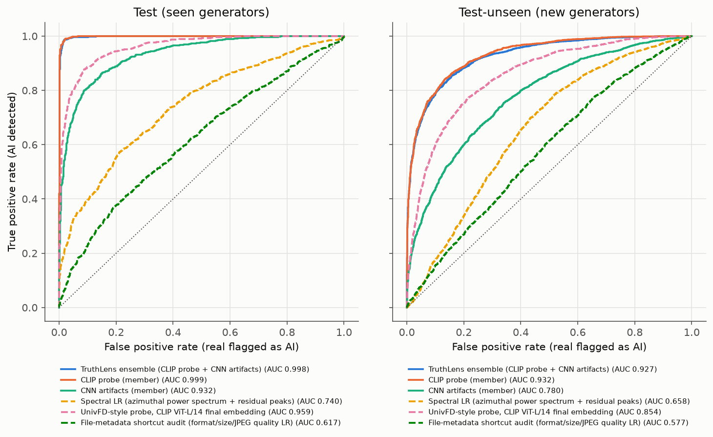

# TruthLens results

_Generated 2026-11-03T15:54:20+0400 by `scripts/eval_models.py` from `reports/metrics.json`._

## Protocol

* Members are trained on TRAIN. Calibration, the ensemble and the uncertainty band are fitted on VAL. The CLIP probe variant is chosen by leave-one-family-out AUC on TRAIN/VAL. Nothing is tuned on a test split.
* TEST shares its 38 generators with training. TEST-UNSEEN holds 32 generators from families never seen in training or selection, plus new real-photo domain(s) (docci), so we report the detection rate on fakes and the false-positive rate on reals separately.
* One preprocessing policy end to end: every image (train, val, test and every upload) is centre-cropped to a square, Lanczos-resized to 224x224 and re-encoded as JPEG q95, exactly as in `normalize_image`. This discards some high-frequency evidence in large photos, but it makes these test numbers representative of the deployed app.
* Family closeness remains between some seen and unseen generators (Flux.1 seen vs Flux.2 unseen; Imagen 3 seen vs Imagen 4 unseen), so a few 'unseen' families are near neighbours of training data.

## Data version

Dataset v2.1: content-filtered (NSFW image classifier, the Stable Diffusion safety checker on CLIP embeddings and a prompt keyword filter, applied identically to real and AI images; 13 generators dropped and replaced with clean, filtered images; split sizes and class balance unchanged). Version 1 results are superseded and archived in `reports/archive_v1/` and `models/archive_v1/`. The two versions differ in content, so the deltas below are for transparency, not a controlled comparison.

* Seen generators (test): AUC 0.998 (v1) -> 0.998 (v2.1), accuracy 0.982 -> 0.982.
* Unseen generators (test_unseen): AUC 0.935 (v1) -> 0.927 (v2.1), accuracy 0.811 -> 0.798.

## Headline (deployed ensemble)

| split | n | accuracy | F1 | ROC-AUC (95% CI) | ECE | detection rate (fakes) | FPR (reals) | coverage | selective acc. |
|---|---|---|---|---|---|---|---|---|---|
| test | 2384 | 0.982 | 0.982 | 0.998 (0.996-0.999) | 0.006 | 0.980 | 0.015 | 0.987 | 0.987 |
| test_unseen | 5326 | 0.798 | 0.757 | 0.927 (0.921-0.934) | 0.168 | 0.628 | 0.032 | 0.941 | 0.816 |

Coverage and selective accuracy refer to images that get a verdict; the rest are labelled Uncertain (calibrated confidence < 0.65).

## Members, ensemble and baselines

| system | kind | test acc | test AUC | test F1 | test ECE | unseen acc | unseen AUC | unseen F1 | unseen ECE | unseen det. rate | unseen FPR |
|---|---|---|---|---|---|---|---|---|---|---|---|
| TruthLens ensemble (CLIP probe + CNN artifacts) | deployed | 0.982 | 0.998 | 0.982 | 0.006 | 0.798 | 0.927 | 0.757 | 0.168 | 0.628 | 0.032 |
| CLIP probe (member) | member | 0.983 | 0.999 | 0.983 | 0.011 | 0.803 | 0.932 | 0.765 | 0.161 | 0.641 | 0.034 |
| CNN artifacts (member) | member | 0.852 | 0.932 | 0.850 | 0.017 | 0.692 | 0.780 | 0.640 | 0.136 | 0.547 | 0.163 |
| UnivFD-style probe, CLIP ViT-B/16 final embedding | baseline | 0.850 | 0.933 | 0.849 | 0.022 | 0.753 | 0.836 | 0.734 | 0.075 | 0.682 | 0.177 |
| UnivFD-style probe, CLIP ViT-L/14 final embedding | baseline | 0.889 | 0.959 | 0.889 | 0.019 | 0.770 | 0.854 | 0.750 | 0.102 | 0.689 | 0.148 |
| Spectral LR (azimuthal power spectrum + residual peaks) | baseline | 0.674 | 0.740 | 0.660 | 0.042 | 0.594 | 0.658 | 0.528 | 0.077 | 0.456 | 0.268 |
| File-metadata shortcut audit (format/size/JPEG quality LR) | baseline | 0.579 | 0.617 | 0.594 | 0.044 | 0.553 | 0.577 | 0.557 | 0.015 | 0.562 | 0.456 |
| Ensemble before calibration (mean raw logit) | ablation | 0.964 | 0.994 | 0.963 | 0.012 | 0.769 | 0.899 | 0.718 | 0.179 | 0.589 | 0.051 |
| Fast fallback ensemble (CLIP ViT-B/16 probe + CNN) | ablation | 0.966 | 0.994 | 0.965 | 0.010 | 0.782 | 0.900 | 0.738 | 0.166 | 0.614 | 0.050 |
| Stacked-LR ensemble (weights fit on VAL) | ablation | 0.984 | 0.999 | 0.984 | 0.007 | 0.805 | 0.933 | 0.768 | 0.164 | 0.643 | 0.032 |
| Ensemble + spectral member | ablation | 0.980 | 0.998 | 0.980 | 0.007 | 0.803 | 0.929 | 0.765 | 0.163 | 0.641 | 0.035 |
| Multi-layer CLIP ViT-B/16 probe (final + intermediate CLS) | ablation | 0.967 | 0.994 | 0.967 | 0.013 | 0.781 | 0.903 | 0.739 | 0.162 | 0.618 | 0.056 |

**Shortcut audit.** A logistic regression on file metadata alone (format, size, JPEG quality, bits per pixel, EXIF) reaches ROC-AUC 0.617 on test and 0.577 on test-unseen after normalisation (raw data: format alone separated the classes). The remaining signal is mostly JPEG bits per pixel, which reflects image texture.

## Per source, test_unseen (deployed ensemble)

Accuracy is the detection rate for AI sources and the specificity (1 - FPR) for real sources.

| source | label | n | accuracy | ROC-AUC vs reals | mean P(AI) |
|---|---|---|---|---|---|
| imagenet | real | 1753 | 0.994 | - | 0.015 |
| docci | real | 460 | 0.893 | - | 0.140 |
| laion | real | 255 | 0.925 | - | 0.084 |
| pexels | real | 195 | 0.969 | - | 0.054 |
| midjourney_v5 | AI | 800 | 0.635 | 0.941 | 0.623 |
| z_image_turbo | AI | 427 | 0.763 | 0.967 | 0.751 |
| flux_2_klein_9b | AI | 337 | 0.208 | 0.795 | 0.234 |
| gpt_image_1_5 | AI | 193 | 0.710 | 0.948 | 0.687 |
| midjourney_7 | AI | 134 | 0.731 | 0.954 | 0.688 |
| veo_3 | AI | 77 | 0.922 | 0.990 | 0.890 |
| ideogram_3_0 | AI | 52 | 0.769 | 0.974 | 0.760 |
| flux_2_dev | AI | 45 | 0.889 | 0.980 | 0.862 |
| recraft_v3 | AI | 42 | 0.333 | 0.808 | 0.320 |
| seedream_v4_0 | AI | 41 | 0.732 | 0.961 | 0.704 |
| wan_video_2_5 | AI | 40 | 0.975 | 0.988 | 0.946 |
| midjourney_6 | AI | 39 | 0.179 | 0.849 | 0.254 |
| dalle_3 | AI | 38 | 0.684 | 0.949 | 0.693 |
| flux_2_klein_4b | AI | 34 | 0.088 | 0.720 | 0.138 |
| flux_2_klein_base_4b | AI | 31 | 0.968 | 0.993 | 0.911 |
| nano_banana_2 | AI | 31 | 0.548 | 0.919 | 0.575 |
| studio_ghibli_wan2_1_t2v_14b_v1_0 | AI | 30 | 0.767 | 0.972 | 0.745 |
| imagen_4_0 | AI | 28 | 0.857 | 0.981 | 0.785 |
| seedream_v4_5 | AI | 28 | 0.607 | 0.932 | 0.568 |
| wan_video_2_2 | AI | 27 | 0.926 | 0.989 | 0.865 |
| gpt_image_1 | AI | 26 | 0.692 | 0.946 | 0.690 |
| gpt_image_2 | AI | 22 | 0.591 | 0.948 | 0.595 |
| lumina_17_2_25 | AI | 21 | 0.905 | 0.991 | 0.896 |
| sora_2 | AI | 21 | 0.667 | 0.875 | 0.650 |
| recraft_v2 | AI | 17 | 0.706 | 0.971 | 0.685 |
| frames_23_1_25 | AI | 15 | 0.733 | 0.956 | 0.693 |
| ideogram_2_0 | AI | 14 | 0.571 | 0.922 | 0.533 |
| seedream_v5_0 | AI | 14 | 0.500 | 0.958 | 0.571 |
| halfmoon_4_4_25 | AI | 11 | 0.455 | 0.950 | 0.493 |
| nano_banana_pro | AI | 11 | 0.727 | 0.976 | 0.706 |
| aurora_20_1_25 | AI | 10 | 0.700 | 0.965 | 0.640 |
| ernie_image | AI | 7 | 0.714 | 0.971 | 0.760 |

## Per source, test (deployed ensemble)

Accuracy is the detection rate for AI sources and the specificity (1 - FPR) for real sources.

| source | label | n | accuracy | ROC-AUC vs reals | mean P(AI) |
|---|---|---|---|---|---|
| imagenet | real | 982 | 0.991 | - | 0.019 |
| laion | real | 137 | 0.942 | - | 0.091 |
| pexels | real | 73 | 0.986 | - | 0.031 |
| adm | AI | 205 | 1.000 | 1.000 | 0.997 |
| wukong | AI | 204 | 0.985 | 0.998 | 0.969 |
| sd15 | AI | 201 | 0.995 | 0.999 | 0.989 |
| vqdm | AI | 192 | 0.969 | 0.997 | 0.960 |
| glide | AI | 180 | 1.000 | 0.999 | 0.994 |
| cyberrealistic_xl_v9_0 | AI | 10 | 1.000 | 0.997 | 0.925 |
| grok_2_image_1212 | AI | 10 | 1.000 | 0.995 | 0.863 |
| sd_xl_v1_0_vae_fix | AI | 10 | 1.000 | 0.999 | 0.991 |
| stable_diffusion_xl_base_1_0 | AI | 10 | 1.000 | 0.999 | 0.992 |
| playground_v2_5_1024px_aesthetic | AI | 9 | 1.000 | 0.999 | 0.979 |
| sdxl_1_0 | AI | 9 | 1.000 | 0.999 | 0.992 |
| flux_realism | AI | 8 | 0.750 | 0.964 | 0.684 |
| qwen_image | AI | 8 | 0.750 | 0.973 | 0.591 |
| sd_1_5_epicdream | AI | 8 | 0.875 | 0.997 | 0.925 |
| flux_mvc5000 | AI | 7 | 1.000 | 0.996 | 0.918 |
| mystic | AI | 7 | 0.857 | 0.994 | 0.874 |
| sdxl_realvis_v5 | AI | 7 | 0.714 | 0.992 | 0.798 |
| sdxl_touchofrealism | AI | 7 | 1.000 | 0.997 | 0.938 |
| sdxl_turbo | AI | 7 | 0.857 | 0.995 | 0.893 |
| kolors_v1_0 | AI | 6 | 1.000 | 0.999 | 0.990 |
| sd_1_5 | AI | 6 | 0.833 | 0.988 | 0.702 |
| sd_2_1 | AI | 6 | 1.000 | 0.998 | 0.969 |
| sd_3_5 | AI | 6 | 0.833 | 0.994 | 0.843 |
| sdxl_epic_realism | AI | 6 | 1.000 | 0.997 | 0.943 |
| sdxl_juggernaut | AI | 6 | 1.000 | 0.998 | 0.972 |
| flux_1_1_pro | AI | 5 | 1.000 | 0.999 | 0.980 |
| flux_1_schnell | AI | 5 | 1.000 | 0.999 | 0.999 |
| hidream_i1_full | AI | 5 | 1.000 | 0.996 | 0.921 |
| sd_turbo | AI | 5 | 1.000 | 1.000 | 1.000 |
| sdxl | AI | 5 | 1.000 | 0.999 | 0.997 |
| stable_diffusion_v1_4 | AI | 5 | 1.000 | 0.997 | 0.944 |
| stable_diffusion_v1_5 | AI | 5 | 1.000 | 0.999 | 1.000 |
| chroma | AI | 4 | 1.000 | 0.996 | 0.890 |
| flux_1_dev | AI | 4 | 0.500 | 0.991 | 0.700 |
| realistic_vision_v5_1_novae | AI | 4 | 1.000 | 0.999 | 0.999 |
| sd_1_5_dreamshaper | AI | 4 | 0.750 | 0.995 | 0.844 |
| flux_amateursnapshotphotos | AI | 3 | 1.000 | 0.999 | 0.999 |
| imagen_3_0_002 | AI | 3 | 1.000 | 0.996 | 0.895 |

## Robustness (deployed ensemble, perturbation then the deployed normalisation)

Subsample: 1000 images per split, stratified by class and source.

| perturbation | unseen acc | unseen AUC | unseen det. rate | unseen FPR | test acc | test AUC |
|---|---|---|---|---|---|---|
| clean | 0.820 | 0.919 | 0.674 | 0.046 | 0.962 | 0.993 |
| jpeg_q90 | 0.684 | 0.847 | 0.352 | 0.012 | 0.840 | 0.959 |
| jpeg_q75 | 0.650 | 0.836 | 0.282 | 0.014 | 0.773 | 0.944 |
| jpeg_q50 | 0.696 | 0.797 | 0.440 | 0.070 | 0.813 | 0.918 |
| downscale_0.5x | 0.639 | 0.882 | 0.976 | 0.668 | 0.636 | 0.975 |
| blur_sigma1 | 0.677 | 0.873 | 0.956 | 0.578 | 0.684 | 0.973 |

## CPU latency

torch.set_num_threads(2) on arm64 with BLAS=accelerate. Apple AMX makes ViT GEMMs much faster than on a 2-vCPU x86 Space; Space numbers must be measured there (predict() returns latency_ms).

| component | median ms | p90 ms |
|---|---|---|
| normalize_224x224 | 1 | 1 |
| clip_224x224 | 154 | 155 |
| cnn_224x224 | 65 | 65 |
| spectral_features_224x224 | 4 | 4 |
| display_spectrum_224x224 | 1 | 1 |
| predict_total_224x224 | 224 | 230 |
| normalize_1024x1024 | 3 | 3 |
| clip_1024x1024 | 154 | 154 |
| cnn_1024x1024 | 64 | 64 |
| spectral_features_1024x1024 | 4 | 4 |
| display_spectrum_1024x1024 | 1 | 1 |
| predict_total_1024x1024 | 243 | 246 |
| normalize_4032x3024 | 13 | 14 |
| clip_4032x3024 | 154 | 154 |
| cnn_4032x3024 | 63 | 64 |
| spectral_features_4032x3024 | 4 | 4 |
| display_spectrum_4032x3024 | 1 | 1 |
| predict_total_4032x3024 | 302 | 306 |
| fast_predict_total_224x224 | 109 | 110 |
| fast_predict_total_1024x1024 | 128 | 129 |
| fast_predict_total_4032x3024 | 187 | 189 |

## CLIP probe selection (leave-one-family-out on TRAIN/VAL)

Deployed: `clip_vitl14_multi`; rule: highest leave-one-family-out mean AUC on TRAIN->VAL (rounded to 3 dp; tie-break: VAL AUC).

| head | dim | CV AUC (train) | VAL AUC | LOFO mean AUC | LOFO min AUC |
|---|---|---|---|---|---|
| clip_vitl14_final | 768 | 0.9587 | 0.9638 | 0.9313 | 0.8777 |
| clip_vitl14_multi | 5888 | 0.9986 | 0.9983 | 0.9850 | 0.9593 |
| clip_vitb16_final | 512 | 0.9358 | 0.9250 | 0.8586 | 0.7713 |
| clip_vitb16_multi | 4352 | 0.9949 | 0.9940 | 0.9620 | 0.8636 |
| freq | 67 | 0.7471 | 0.7423 | 0.6921 | 0.5147 |
| meta | 12 | 0.6088 | 0.5949 | 0.5358 | 0.2446 |

## Caveats

* All sources are non-commercial research datasets. About 84% of TRAIN AI images are GenImage (ImageNet content, 2022-era generators); modern generators contribute 1180 training images, so they are up-weighted by source pool (alpha = 0.5, fixed in advance).
* Many unseen generators have fewer than 50 images, so their per-source rates have wide uncertainty.
* Known failure modes from the robustness table: blur and upsampling make real photos look generated (ranking AUC stays high but the 0.5 threshold produces many false positives), and JPEG recompression hides generator traces (more missed fakes). Inputs smaller than 224 px are therefore answered with 'Uncertain' in the app; blur cannot be detected reliably and remains a limitation.
* The pre-registered ensemble (equal-weight calibrated logits) is slightly below the CLIP probe alone on clean test sets, but more robust under JPEG compression. The stacked-LR row is shown for comparison only and was not selected after seeing test results.
* Robustness numbers use a stratified subsample and perturb the 224 px normalised image. An upload degraded at full resolution is partly 'cleaned' by the downscale, so these numbers are conservative.
* CPU latency was measured on Apple silicon (AMX-accelerated matrix multiplies); a small x86 CPU is slower. The live Space runs on ZeroGPU (measured numbers in the README). `predict()` reports `latency_ms` live.
* Calibration is fitted on VAL (seen generators). On unseen generators the probabilities are less reliable; see the test-unseen ECE and the reliability diagram.

## Figures

